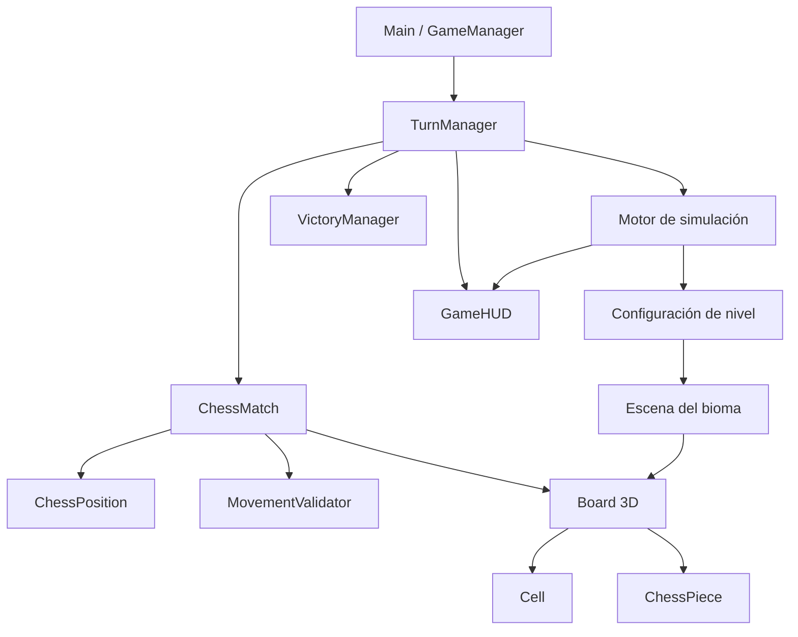

# Arquitectura

## Principios

El proyecto separa las reglas puras de ajedrez, la representación 3D, la
simulación ambiental y la interfaz. Las reglas no dependen de simulación ni de
nodos visuales; la integración coordina los módulos y traduce eventos.

## Módulos y responsabilidades

| Módulo | Responsabilidad | No debe hacer |
|---|---|---|
| `Board` | Matriz 8 × 8, ocupación, coordenadas, entrada y resaltados | Validar jaque o movimientos FIDE |
| `ChessPosition` | Estado serializable de la partida, FEN, turno y derechos | Crear nodos 3D |
| `MovementValidator` | Generar y validar jugadas legales y estados finales | Leer parámetros ambientales |
| `ChessMatch` | Sincronizar reglas con `Board` y emitir jugadas | Decidir objetivos de nivel |
| Simulación | Evolución ambiental, agentes, vivero y métricas | Alterar reglas internas sin contrato |
| Bioma/UI | Escena, tema, HUD y presentación | Calcular reglas o simulaciones |
| Integración | Orden de fases, niveles, victoria/derrota y señales | Duplicar lógica de piezas |

## Flujo de datos y eventos

`Board.cell_clicked` entrega una coordenada. El gestor consulta
`ChessMatch.legal_moves_from`; si el destino es legal, llama a
`ChessMatch.play`. `ChessMatch.move_played` actualiza historial y permite al
gestor ejecutar las fases ambientales. Al terminar, el gestor envía resultados
al HUD con métodos `set_*` y evalúa el estado de la partida.

Las señales son eventos, no almacenamiento de estado. El estado canónico de
ajedrez es `ChessPosition`; el estado visual canónico es la ocupación de
`Board`; el estado ambiental debe pertenecer al motor de simulación.

## Dependencias

`Board` puede funcionar sin reglas. `MovementValidator` depende de
`ChessPosition` y de utilidades geométricas de `Board`. `ChessMatch` depende de
ambos. Simulación y UI deben consumir contratos de integración, no acceder a
campos privados. Las escenas de bioma pueden cambiar `BoardTheme` sin cambiar
la legalidad de una jugada.