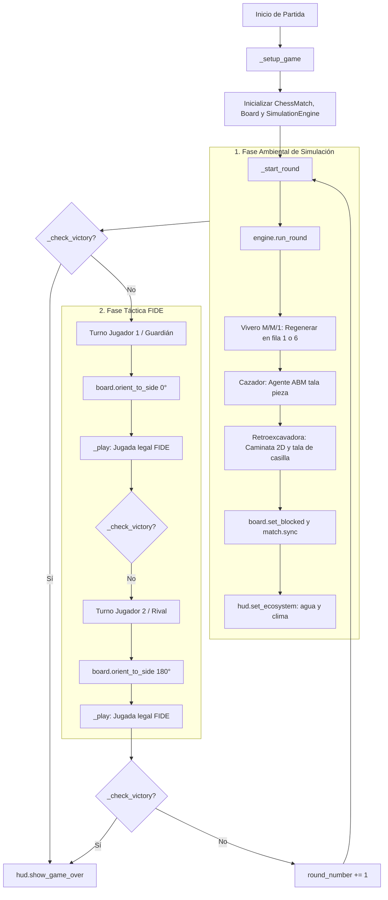

# Integrante 5 — Integración y progresión

**Responsable**: Juan Diego Sanchez  
**Módulo**: Integración de partida, orquestación de sistemas, progresión de niveles y fin de juego.

---

## 1. Alcance Implementado

Construcción y orquestación de la partida jugable completa en Godot 4.7.2:
- Escena principal integrada (`scenes/main/Main.tscn`) controlada por `GameManager` (`scripts/game/game_manager.gd`).
- Partida local de dos jugadores (*hotseat*) con rotación física del tablero de 180° entre turnos.
- Orquestación acoplada sin duplicar lógica: `ChessMatch` (reglas FIDE), `SimulationEngine` (modelos matemáticos y ambientales) y `GameHUD` (interfaz diegética y retroalimentación visual).
- Progresión de niveles por rondas (Nivel 1: Páramo, Nivel 2: Amazonía, Nivel 3: Santuario con retroexcavadora).
- Gestión del ciclo ambiental: regeneración de frailejones en el vivero $M/M/1$, desplazamiento del agente Cazador Furtivo, caminata aleatoria de la Retroexcavadora con tala y bloqueo permanente de casillas.
- Evaluación unificada de condiciones de victoria (FIDE, colapso hídrico, desertificación mutua y ronda 30).
- Suite de pruebas de integración automatizadas (`tests/integration/test_integration.gd`).

---

## 2. Archivos del Módulo

| Archivo | Tipo | Descripción |
|---|---|---|
| `scenes/main/Main.tscn` | Escena (`Node3D`) | Escena raíz del juego: contiene `GameManager`, `Environment`, `Board`, `Camera3D` y capa `UI` |
| `scripts/game/game_manager.gd` | Script GDScript | Controlador central de la partida: acopla tablero, reglas de ajedrez, simulación, cámara y HUD |
| `tests/integration/test_integration.gd` | Suite de pruebas | Pruebas de integración automatizadas en modo *headless* para todas las mecánicas del Rol 5 |
| `scripts/ui/main_menu.gd` | Modificación | Conexión con `Main.tscn`, soporte de selección de niveles y créditos de los 5 integrantes |
| `scripts/ui/game_hud.gd` | Modificación | Corrección del centrado y área interactiva (*hitbox*) de los botones de ayuda superiores |
| `scripts/ui/hud_icon.gd` | Modificación | Dibujo vectorial centrado con parámetro configurable `icon_size` |
| `tests/ui/test_main_menu.gd` | Modificación | Compatibilidad de pruebas del menú con la escena integrada `Main.tscn` |

---

## 3. Arquitectura y Ciclo de Ejecución



---

## 4. Componentes Clave

### 4.1. Acoplamiento de la Fase Ambiental (`_apply_environment`)
En cada ronda (`_start_round`), antes de que los jugadores muevan, el motor simula el entorno estocástico:
1. **Regeneración en Vivero $M/M/1$**: Las plantas que completan servicio en la cola exponencial se reinsertan en la primera casilla libre de su fila base (`first_empty_in_row(1)` para Blancas, `first_empty_in_row(6)` para Negras). Si la fila está llena, se reencolan automáticamente.
2. **Cazador Furtivo**: Si se desplaza a una casilla ocupada, tala la pieza, la traslada a la bandeja de capturas y, si era un peón (frailejón), lo envía a la cola del vivero.
3. **Retroexcavadora (Nivel 3)**: Aparece en la ronda 21. Realiza una caminata aleatoria 2D. Destruye piezas a su paso y tala irreversiblemente la casilla que abandona (`board.set_blocked()`), dejándola intransitable.
4. **Sincronización**: Al terminar la fase ambiental, `_match.sync()` actualiza el estado formal de `ChessPosition` a partir de la geometría visual del tablero.

### 4.2. Control de Cámara y Panorámica Dinámica
- La cámara orbital soporta giro con clic derecho/medio y zoom con rueda del ratón.
- **Botón de Vista Panorámica (Montaña) / Tecla V**: Mediante `_fly_to` y un `tween_method`, la cámara interpola suavemente entre la vista aérea de juego (`PLAY_VIEW`: inclinación 52°, distancia 17.5) y la vista panorámica baja (`PANORAMA_VIEW`: inclinación 11°, distancia 30.0), ejecutando `_update_camera()` en cada paso de interpolación.
- **Atajos de Teclado**:
  - `V`: Alternar vista aérea / panorámica.
  - `Tab`: Desplegar / ocultar panel de jugadas.
  - `F1`: Menú de depuración y pruebas ambientales.
  - `Esc`: Menú de pausa.

### 4.3. Bandeja de Capturas (`_send_to_tray`)
Las piezas capturadas por combate de ajedrez o taladas por los desestabilizadores se trasladan suavemente con un *tween* hacia los laterales del tablero (`CapturedTray`), escalándose a 0.62 para formar el cementerio visible de fauna y flora.

### 4.4. Limpieza en Reinicio (`_reset`)
Al reiniciar la partida o cambiar de nivel:
- Se limpian las casillas bloqueadas (`board.clear_blocked()`).
- Se retiran todos los resaltados (`board.clear_highlights()`).
- Se vacía la bandeja de capturas y el historial del HUD (`hud.clear_moves()`).
- Se oculta la capa de fin de juego (`hud.hide_game_over()`).
- La ronda se reinicia al valor base del nivel seleccionado (Ronda 1 para Nivel 1, Ronda 11 para Nivel 2, Ronda 21 para Nivel 3).

---

## 5. Solución de Problemas Técnicos de la Fase

| Problema Encontrado | Causa Raíz | Solución Aplicada |
|---|---|---|
| **Fallo en Nivel 3 (`set_blocked` inexistente)** | Se intentó llamar a `_match.position.set_blocked()`, función no implementada en `ChessPosition`. | Se delegó el bloqueo a `board.set_blocked()` seguido de `_match.sync()`, que sincroniza nativamente las casillas bloqueadas en `position.blocked`. |
| **Área táctil (*hitbox*) de botones del HUD desplazada** | `_icon_button` combinaba `PRESET_CENTER` con `position = Vector2(9, 9)`, desplazando el icono 18 px fuera del botón. | Se asignó `PRESET_FULL_RECT` y se parametrizó `icon_size: float = 18.0` en `HudIcon` para centrado matemático exacto. |
| **Botón de vista panorámica estático** | `_toggle_panorama` utilizaba `tween_property` sin invocar `_update_camera()` durante la animación. | Se implementó `_fly_to` con `tween_method` ejecutando `_update_camera()` cuadro a cuadro, y se agregó el atajo de teclado `V`. |
| **Sincronización de clima en el HUD** | El clima mostrado re-muestreaba aleatoriamente en vez de reflejar el resultado de la ronda. | Se almacenó `_current_climate_str = result.climate_label()` al iniciar la ronda para sincronización estricta. |

---

## 6. Verificación y Pruebas Automatizadas

La suite `tests/integration/test_integration.gd` verifica el comportamiento integral del juego sin interfaz gráfica:

```bash
godot --headless --path . --script res://tests/integration/test_integration.gd
```

### Casos de Prueba Integrados (24 comprobaciones):
1. **Inicialización**: Colocación inicial FIDE, cazador en d4 (3,3), reservas hídricas al 100%.
2. **Ronda ambiental**: Simulación de clima, dos acumuladores de agua y transición del agente cazador.
3. **Alternancia y giro**: Turno 1 en blancas (0°), jugada 1. e4, cambio a negras y giro del tablero a 180°.
4. **Vivero $M/M/1$**: Captura de peón y encolado en el sistema de espera.
5. **Nivel 3**: Generación de retroexcavadora en ronda 21, caminata 2D y bloqueo físico/lógico de casilla talada.
6. **Veredicto y fin de juego**: Detección de colapso hídrico y asignación de ganador.

**Resultado de la suite**: 24 comprobaciones, 0 fallidas (100% de éxito).  
**Resultado global del proyecto**: 388 comprobaciones en 5 suites, 0 fallidas.
